# Screenshots

[Home](README.en.md) · [Documentation](../en/README.md)

Screenshots use demo data; the interface changes between versions.

## Desktop control panel

<table>
<tr>
<td align="center" valign="top" width="50%">
<picture>
  <source media="(prefers-color-scheme: dark)" srcset="../../assets/readme/panel-home-dark.webp">
  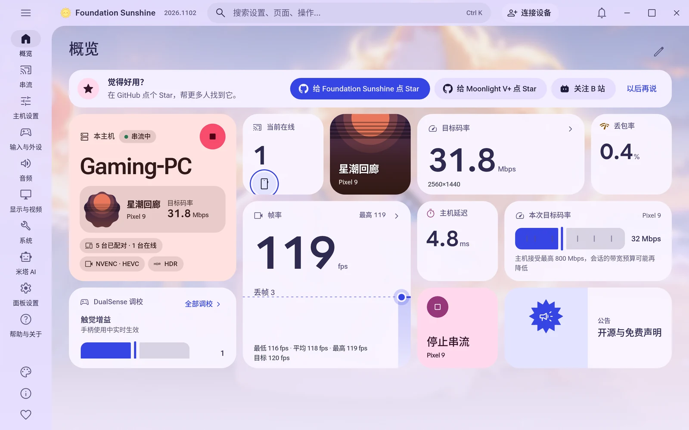
</picture> 
Overview
</td>
<td align="center" valign="top" width="50%">
<picture>
  <source media="(prefers-color-scheme: dark)" srcset="../../assets/readme/panel-library-dark.webp">
  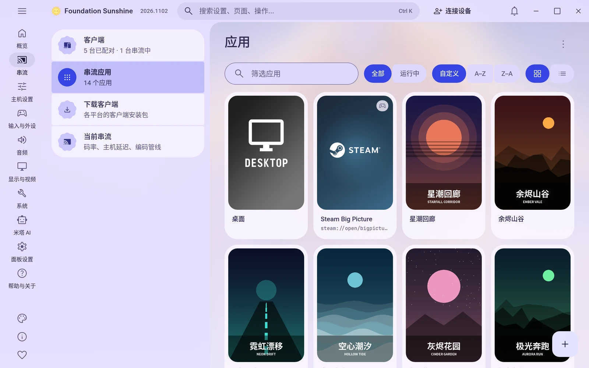
</picture> 
Game library
</td>
</tr>
<tr>
<td align="center" valign="top" width="50%">
<picture>
  <source media="(prefers-color-scheme: dark)" srcset="../../assets/readme/panel-app-editor-dark.webp">
  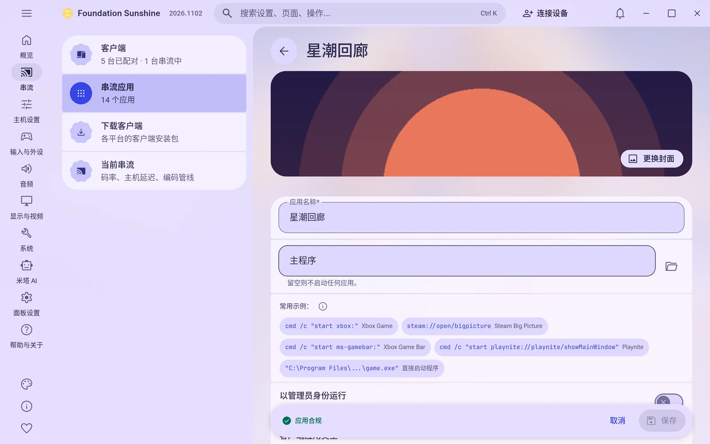
</picture> 
App editor
</td>
<td align="center" valign="top" width="50%">
<picture>
  <source media="(prefers-color-scheme: dark)" srcset="../../assets/readme/panel-display-dark.webp">
  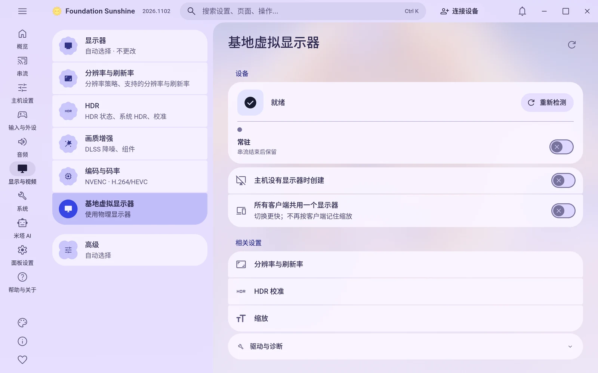
</picture> 
Displays
</td>
</tr>
<tr>
<td align="center" valign="top" width="50%">
<picture>
  <source media="(prefers-color-scheme: dark)" srcset="../../assets/readme/panel-gamepad-dark.webp">
  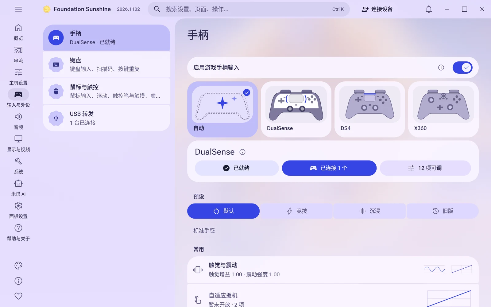
</picture> 
Controllers · DualSense
</td>
<td align="center" valign="top" width="50%">
<picture>
  <source media="(prefers-color-scheme: dark)" srcset="../../assets/readme/panel-appearance-dark.webp">
  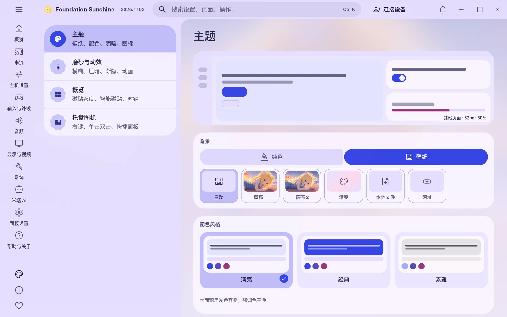
</picture> 
Personalization
</td>
</tr>
<tr>
<td align="center" valign="top" width="50%">
<picture>
  <source media="(prefers-color-scheme: dark)" srcset="../../assets/readme/panel-components-dark.webp">
  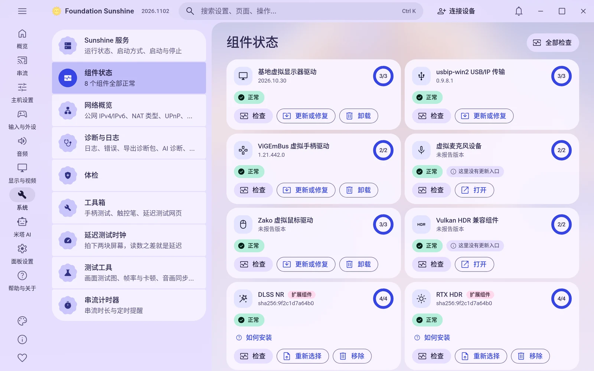
</picture> 
Components
</td>
<td align="center" valign="top" width="50%">
<picture>
  <source media="(prefers-color-scheme: dark)" srcset="../../assets/readme/panel-stream-dark.webp">
  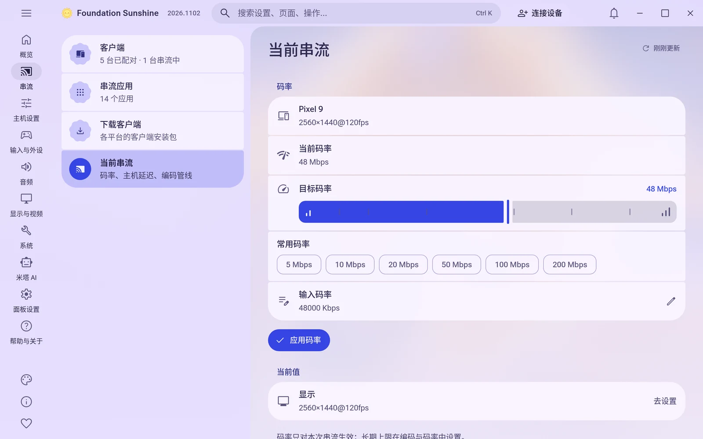
</picture> 
Current stream
</td>
</tr>
</table>

## Tray

<table>
<tr>
<td align="center" valign="top">
<picture>
  <source media="(prefers-color-scheme: dark)" srcset="../../assets/readme/panel-tray-dark.webp">
  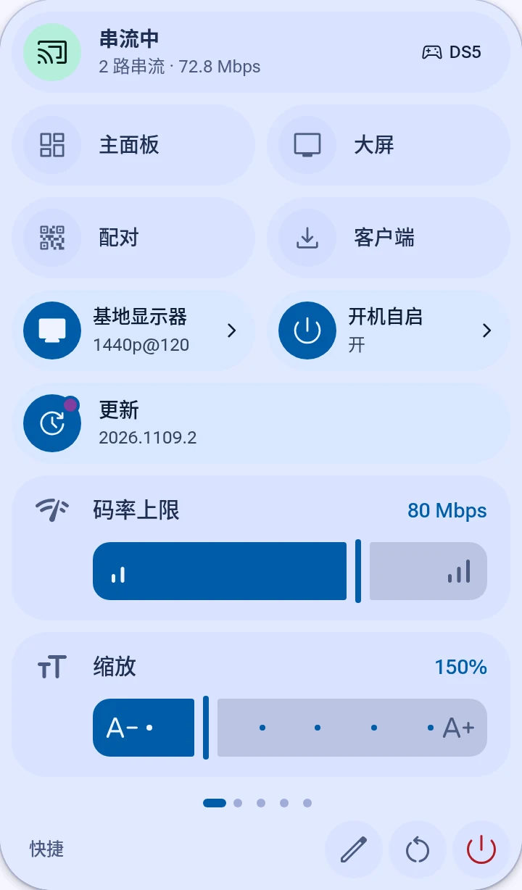
</picture> 
Tray quick panel
</td>
</tr>
</table>

## Web management UI

<table>
<tr>
<td align="center" valign="top" width="50%">
<picture>
  <source media="(prefers-color-scheme: dark)" srcset="../../assets/readme/web-home-dark.webp">
  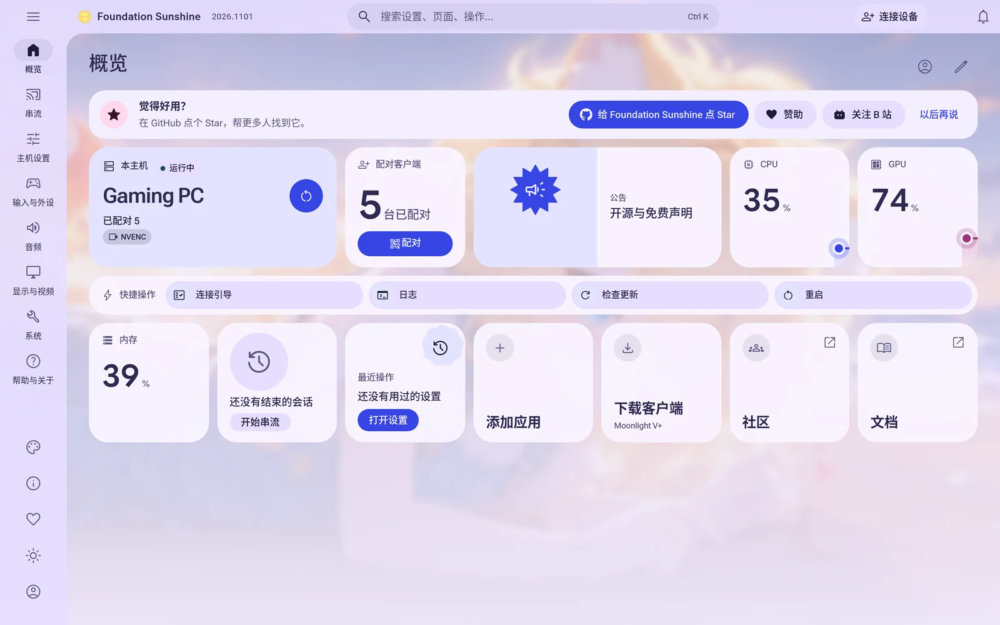
</picture> 
Overview
</td>
<td align="center" valign="top" width="50%">
<picture>
  <source media="(prefers-color-scheme: dark)" srcset="../../assets/readme/web-apps-dark.webp">
  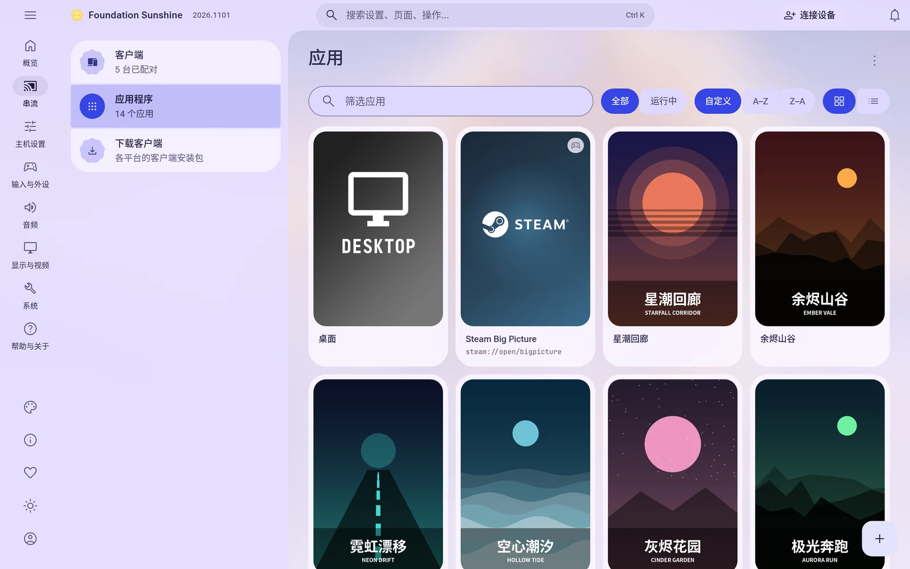
</picture> 
Applications
</td>
</tr>
<tr>
<td align="center" valign="top" width="50%">
<picture>
  <source media="(prefers-color-scheme: dark)" srcset="../../assets/readme/web-app-editor-dark.webp">
  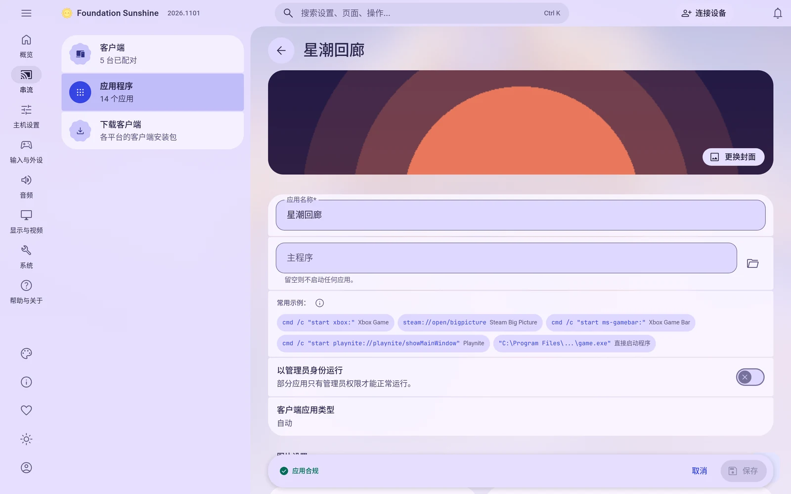
</picture> 
App editor
</td>
<td align="center" valign="top" width="50%">
<picture>
  <source media="(prefers-color-scheme: dark)" srcset="../../assets/readme/web-encoders-dark.webp">
  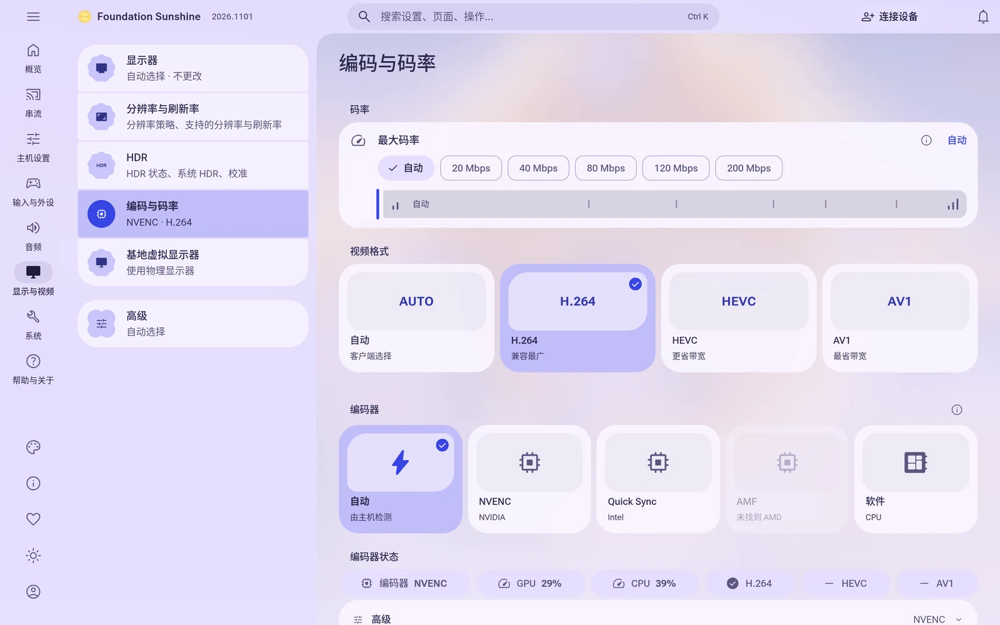
</picture> 
Encoding and bitrate
</td>
</tr>
<tr>
<td align="center" valign="top" width="50%">
<picture>
  <source media="(prefers-color-scheme: dark)" srcset="../../assets/readme/web-pin-dark.webp">
  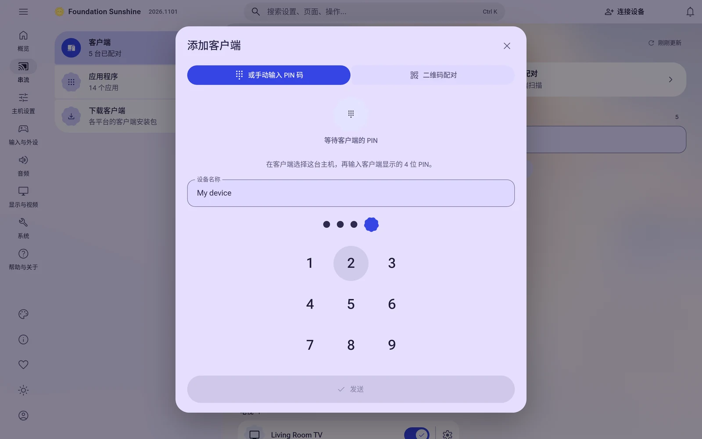
</picture> 
PIN pairing
</td>
<td align="center" valign="top" width="50%">
<picture>
  <source media="(prefers-color-scheme: dark)" srcset="../../assets/readme/web-diagnostics-dark.webp">
  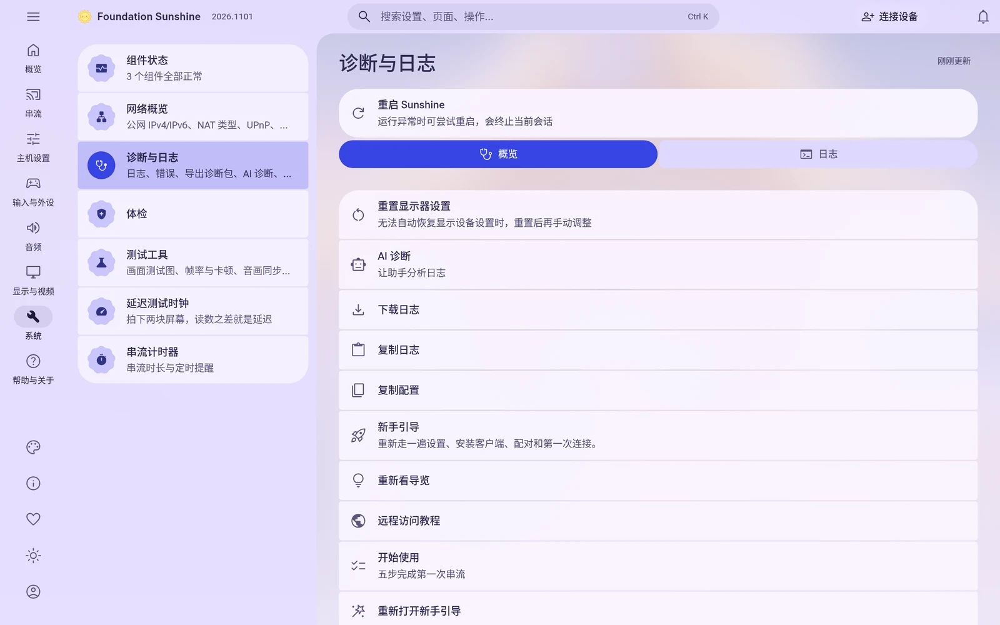
</picture> 
Diagnostics and logs
</td>
</tr>
</table>

## Phone

<table>
<tr>
<td align="center" valign="top" width="33%">
<picture>
  <source media="(prefers-color-scheme: dark)" srcset="../../assets/readme/phone-home-dark.webp">
  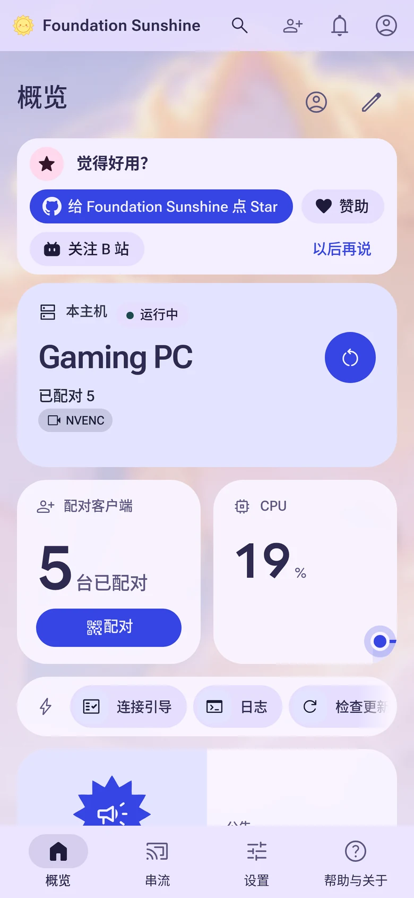
</picture> 
Overview
</td>
<td align="center" valign="top" width="33%">
<picture>
  <source media="(prefers-color-scheme: dark)" srcset="../../assets/readme/phone-apps-dark.webp">
  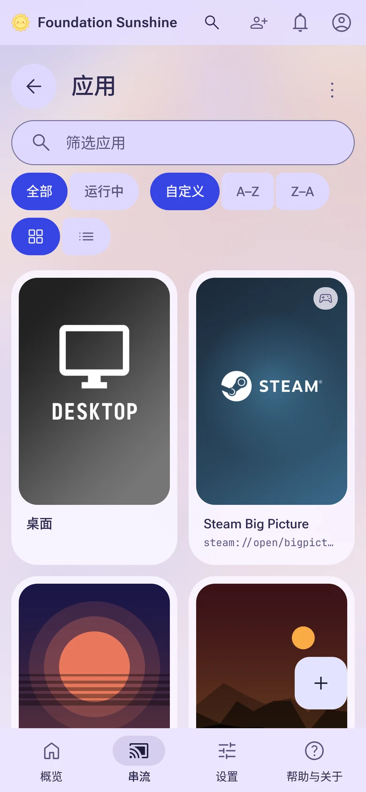
</picture> 
Applications
</td>
<td align="center" valign="top" width="33%">
<picture>
  <source media="(prefers-color-scheme: dark)" srcset="../../assets/readme/phone-pin-dark.webp">
  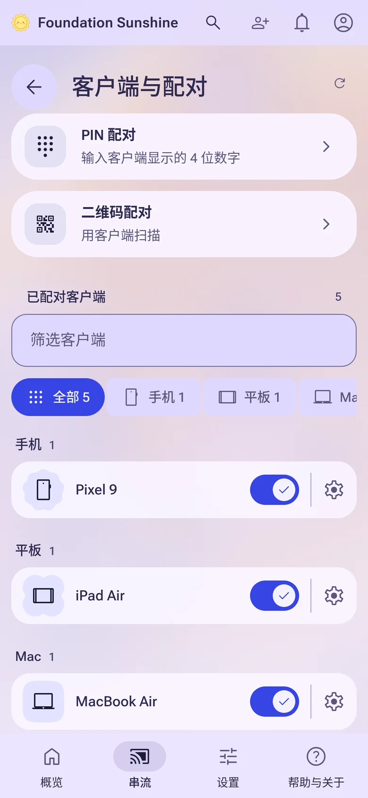
</picture> 
Clients and pairing
</td>
</tr>
</table>
