# 截图

[项目首页](../../README.md) · [文档目录](../zh-CN/README.md)

截图使用演示数据，界面随版本更新会有变化。

## 桌面控制面板

<table>
<tr>
<td align="center" valign="top" width="50%">
<picture>
  <source media="(prefers-color-scheme: dark)" srcset="../../assets/readme/panel-home-dark.webp">
  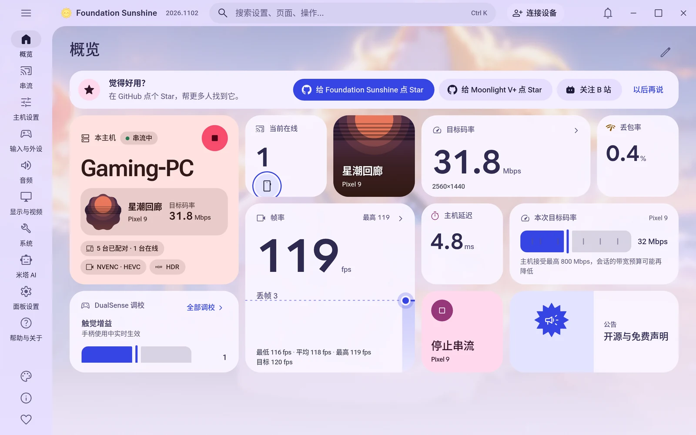
</picture> 
概览
</td>
<td align="center" valign="top" width="50%">
<picture>
  <source media="(prefers-color-scheme: dark)" srcset="../../assets/readme/panel-library-dark.webp">
  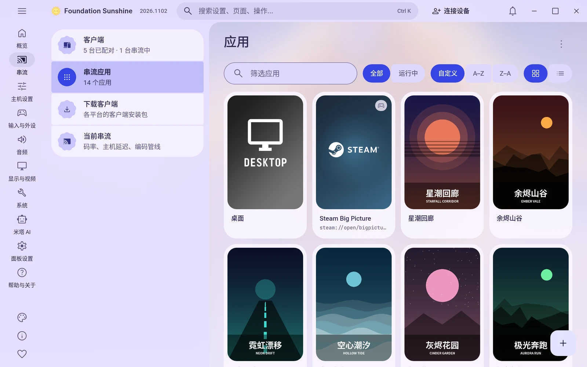
</picture> 
游戏库
</td>
</tr>
<tr>
<td align="center" valign="top" width="50%">
<picture>
  <source media="(prefers-color-scheme: dark)" srcset="../../assets/readme/panel-app-editor-dark.webp">
  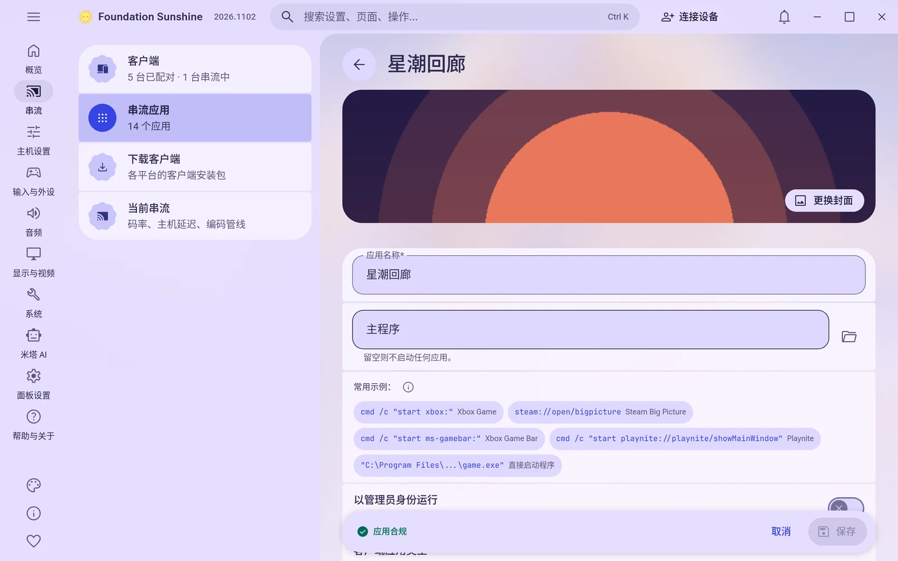
</picture> 
应用编辑
</td>
<td align="center" valign="top" width="50%">
<picture>
  <source media="(prefers-color-scheme: dark)" srcset="../../assets/readme/panel-display-dark.webp">
  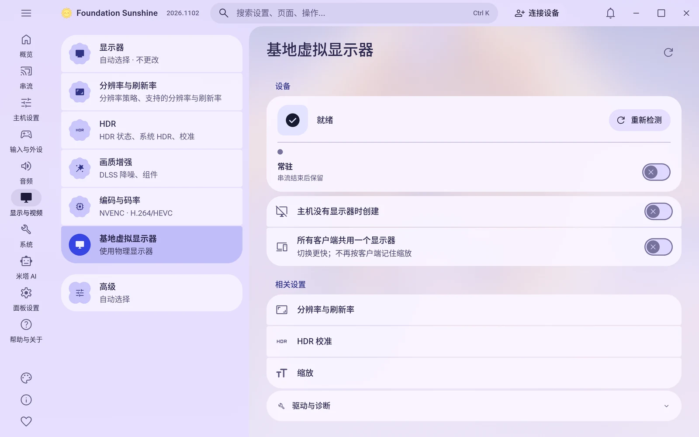
</picture> 
显示器
</td>
</tr>
<tr>
<td align="center" valign="top" width="50%">
<picture>
  <source media="(prefers-color-scheme: dark)" srcset="../../assets/readme/panel-gamepad-dark.webp">
  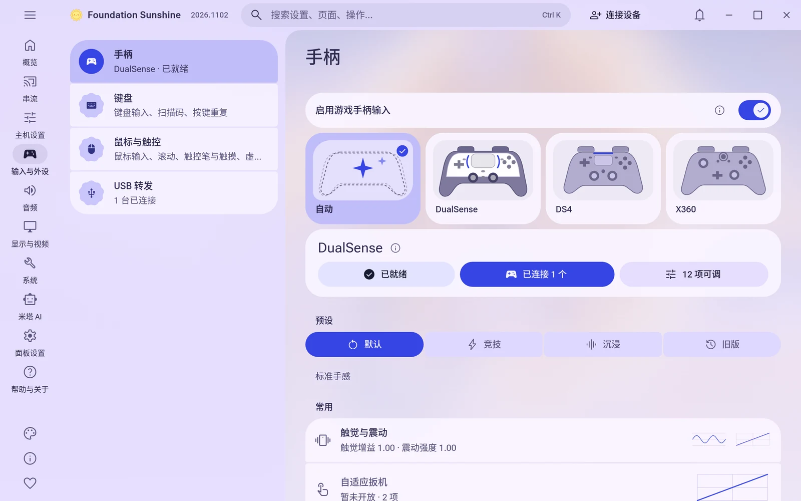
</picture> 
手柄 · DualSense
</td>
<td align="center" valign="top" width="50%">
<picture>
  <source media="(prefers-color-scheme: dark)" srcset="../../assets/readme/panel-appearance-dark.webp">
  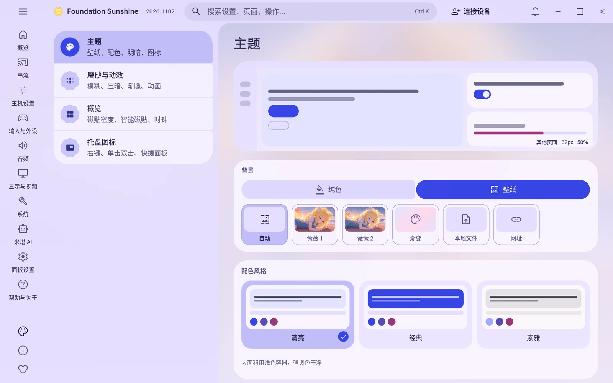
</picture> 
个性化
</td>
</tr>
<tr>
<td align="center" valign="top" width="50%">
<picture>
  <source media="(prefers-color-scheme: dark)" srcset="../../assets/readme/panel-components-dark.webp">
  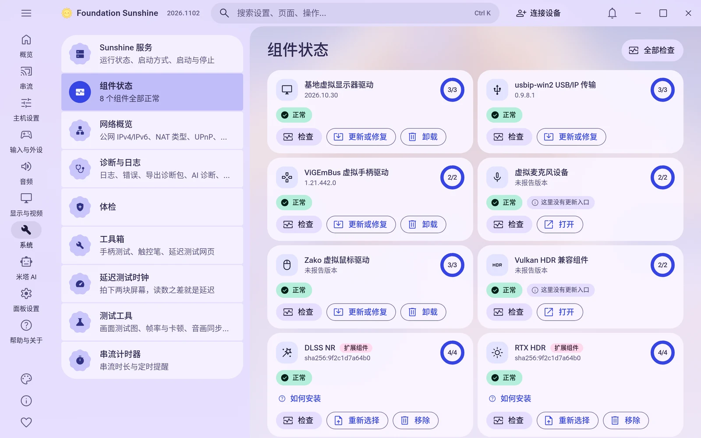
</picture> 
组件
</td>
<td align="center" valign="top" width="50%">
<picture>
  <source media="(prefers-color-scheme: dark)" srcset="../../assets/readme/panel-stream-dark.webp">
  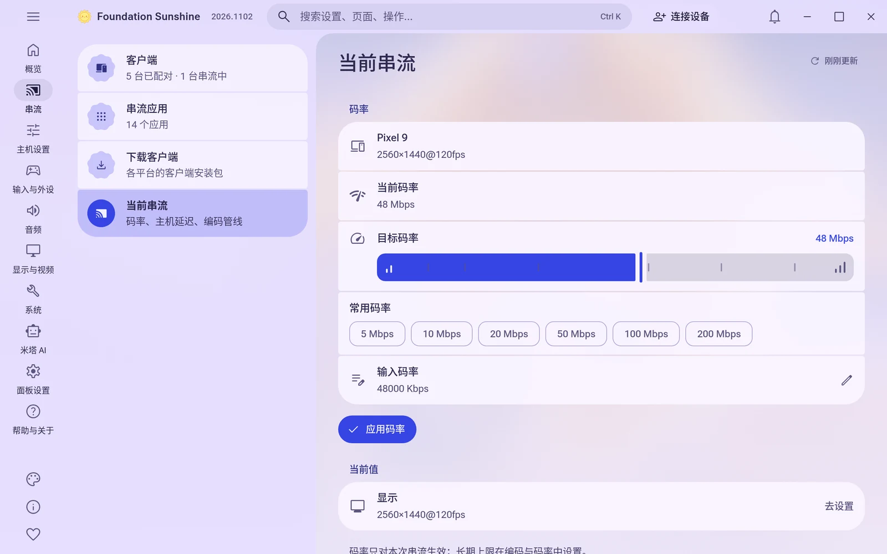
</picture> 
当前串流
</td>
</tr>
</table>

## 托盘

<table>
<tr>
<td align="center" valign="top">
<picture>
  <source media="(prefers-color-scheme: dark)" srcset="../../assets/readme/panel-tray-dark.webp">
  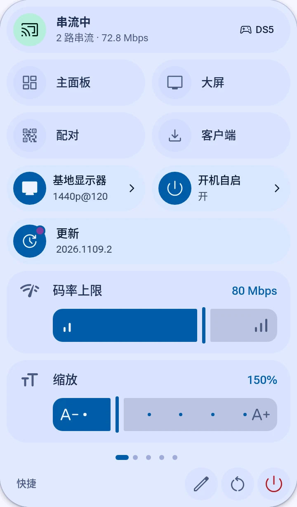
</picture> 
托盘快捷面板
</td>
</tr>
</table>

## 网页管理界面

<table>
<tr>
<td align="center" valign="top" width="50%">
<picture>
  <source media="(prefers-color-scheme: dark)" srcset="../../assets/readme/web-home-dark.webp">
  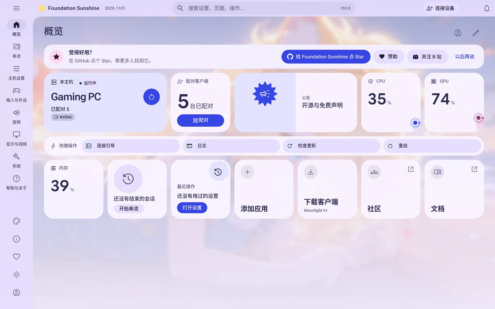
</picture> 
概览
</td>
<td align="center" valign="top" width="50%">
<picture>
  <source media="(prefers-color-scheme: dark)" srcset="../../assets/readme/web-apps-dark.webp">
  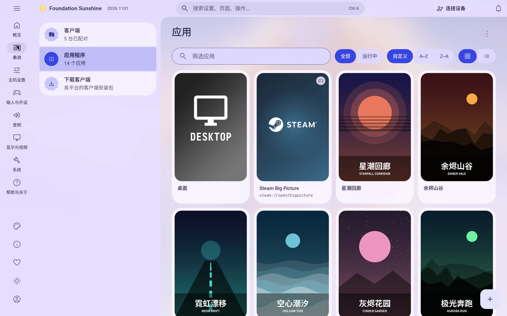
</picture> 
应用
</td>
</tr>
<tr>
<td align="center" valign="top" width="50%">
<picture>
  <source media="(prefers-color-scheme: dark)" srcset="../../assets/readme/web-app-editor-dark.webp">
  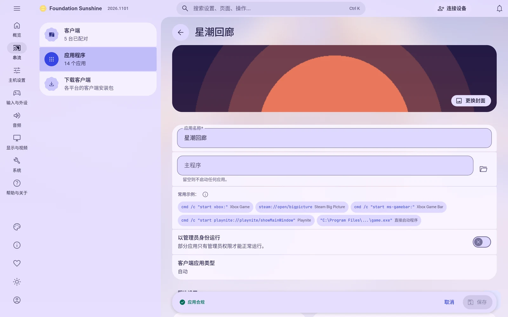
</picture> 
应用编辑
</td>
<td align="center" valign="top" width="50%">
<picture>
  <source media="(prefers-color-scheme: dark)" srcset="../../assets/readme/web-encoders-dark.webp">
  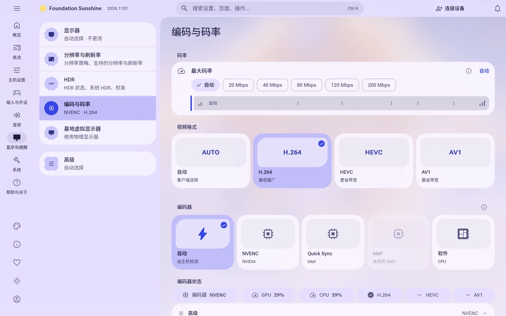
</picture> 
编码与码率
</td>
</tr>
<tr>
<td align="center" valign="top" width="50%">
<picture>
  <source media="(prefers-color-scheme: dark)" srcset="../../assets/readme/web-pin-dark.webp">
  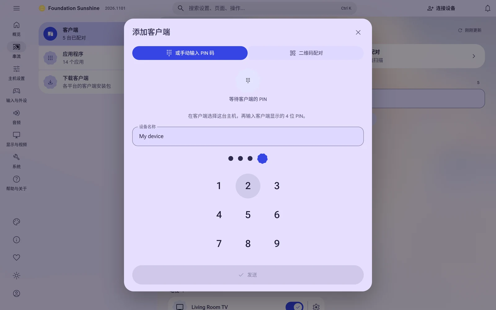
</picture> 
PIN 配对
</td>
<td align="center" valign="top" width="50%">
<picture>
  <source media="(prefers-color-scheme: dark)" srcset="../../assets/readme/web-diagnostics-dark.webp">
  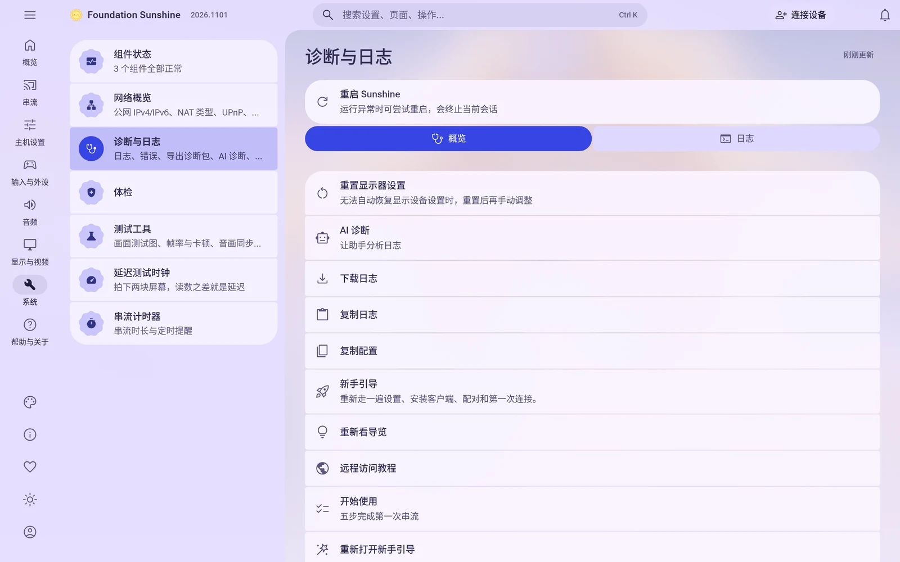
</picture> 
诊断与日志
</td>
</tr>
</table>

## 手机

<table>
<tr>
<td align="center" valign="top" width="33%">
<picture>
  <source media="(prefers-color-scheme: dark)" srcset="../../assets/readme/phone-home-dark.webp">
  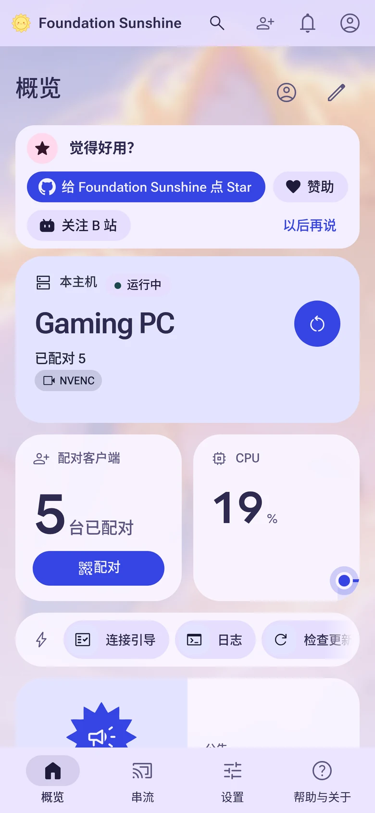
</picture> 
概览
</td>
<td align="center" valign="top" width="33%">
<picture>
  <source media="(prefers-color-scheme: dark)" srcset="../../assets/readme/phone-apps-dark.webp">
  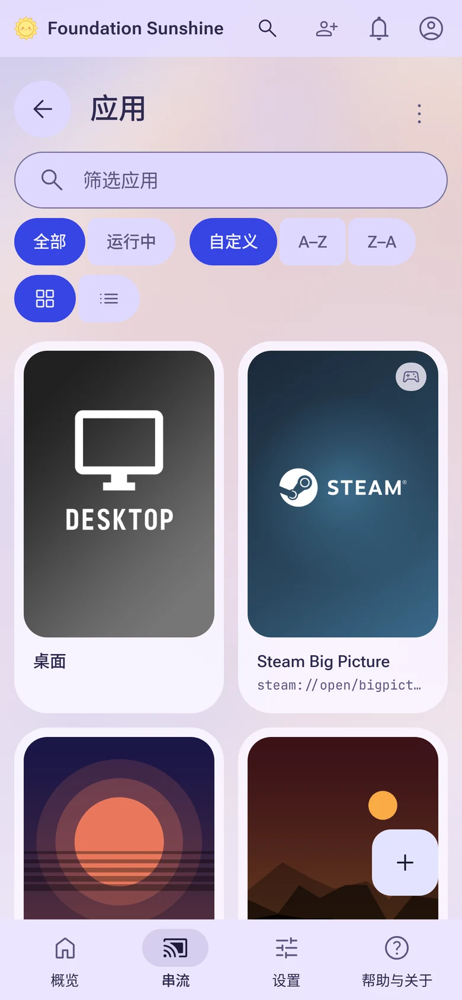
</picture> 
应用
</td>
<td align="center" valign="top" width="33%">
<picture>
  <source media="(prefers-color-scheme: dark)" srcset="../../assets/readme/phone-pin-dark.webp">
  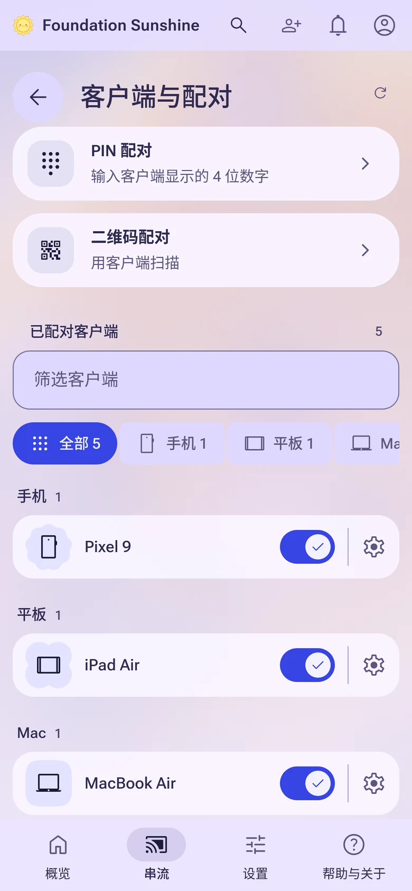
</picture> 
客户端与配对
</td>
</tr>
</table>
